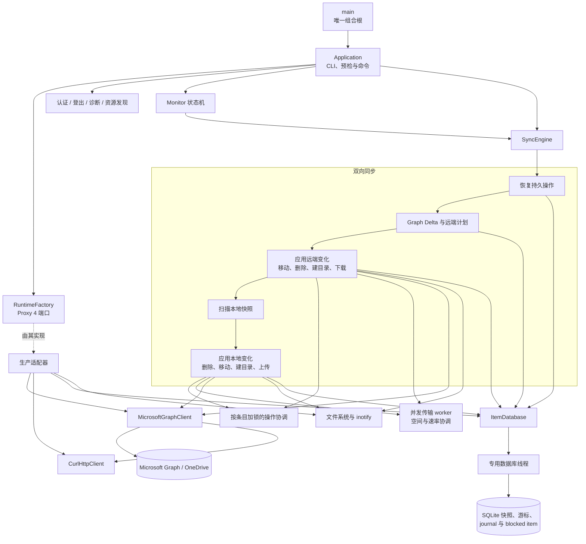

# 架构

[English](architecture.md) | 简体中文 |
[文档中心](README.zh-CN.md)

## 系统总览

## 依赖与存储边界

应用通过构造器注入依赖，并使用明确的端口接口，不采用 Service Locator。`main`
是唯一的组合根（composition root）。加载配置后，生产环境的运行时工厂
（runtime factory）会创建 libcurl、文件 token、SQLite、monitor、Graph 和
metrics 适配器；测试则注入内存实现（fake）。这样，业务编排无需依赖具体的
基础设施实现，检测逻辑（instrumentation）也能通过稳定端口与编排解耦。

运行时端口使用 Proxy 4 类型擦除。适配器只需提供所要求的操作，无需继承项目
定义的抽象基类。

SQLite ItemStore 使用专用数据库线程。下载、监控和上传工作线程发起调用后，
请求会排队，并同步等待执行结果。因此，SQLite 连接和事务顺序始终由同一线程
管理，错误则返回调用方。SQLite 是状态的权威来源，适配器不再重复维护可变的
条目缓存。

`src/storage/item_mapping.hpp` 中的私有 Data Mapper 让单条写入和事务内的 Delta
写入共用条目 upsert SQL、快照绑定及行读取。待提交下载和分片下载只共用相同的
journal 字段；本地快照元数据与 journal 特有的列布局保持分离。数据库线程归属、
Statement 复用、事务边界和错误处理仍由调用方负责，数据库 schema 不变。

协议与策略上限在各自所属作用域中命名。HTTP、认证和 Graph 共用
`src/http/status.hpp` 中的状态码与状态码类别判断；Graph JSON 请求共用
`src/graph/support.hpp` 中的响应大小上限。SHA-256 摘要与十六进制长度定义在
`onedrive/util/sha256.hpp` 中。浏览器传输复用 `BrowserRequest::request_limit`，
文件系统缓冲区、名称分配尝试次数和 SQLite 连接上限则保留为局部常量。
这些命名不改变协议数值、持久化格式或重试行为。

Graph 写操作通过私有请求装饰函数复用上传传输的超时、HTTP／IP 版本及 JSON
响应上限映射。认证头、限速策略、进度回调、取消及重试／错误处理仍由各操作
负责。预认证的上传分片不会附加 Graph 认证头，总限速与单文件传输限速也不合并。

`AccountState` 是账号激活、稳定路径和只读 Drive 查询的 Facade（门面）。
私有 Data Mapper 函数负责 `DriveIdentity` 与账号／Drive JSON 的转换，
文件权限、Drive 选择和原子写入不混入转换逻辑。CLI 登录和状态复用
`account_fields` Presenter，与既有 Drive／配额字段展示方式一致。
GUI 翻译仍由 Qt 负责，不让领域模型依赖本地化标签；缺失类型保持未知，
Graph 返回的未来类型原值保留。

多 Drive 编排由同步和 Monitor 共用的私有 `DriveSet` 负责。每个目标独立持有
Graph 客户端、状态库、指标、目录租约和预览缓存作用域；整轮顺序执行并汇总
单盘错误，强类型的账号认证错误则立即传播。Monitor 保留单一控制端点和调度器，
为所有配置的 Drive 分别维护通知状态机。

## Delta 目录树

Personal 和 Business 共用私有 `DeltaHierarchyResolver`。`parse_delta_item`
Data Mapper 将两种响应规范化为 `RemoteItem`，缺失 cTag 保持可选，内容哈希验证
延迟到祖先关系明确之后。已提供的 size 必须为整数；非法类型明确失败，不静默变成 0。
解析器按元数据组合根目录、父 ID 和显式路径策略，
不按账号类型建立独立引擎，也不从 Drive 类型猜测能力。祖先查询通过依赖注入提供；
网络访问、OAuth、分页和持久化仍留在解析器之外。

Delta 收齐所有分页并按 item ID 保留最后一次记录后，再解析路径。当前父目录 ID
关系优先于已保存目录路径和可选路径提示；解析器复用已保存目录树，缺失祖先时按 ID
查询，同一批次只查询一次。不再把缺少父路径当成条目位于根目录的证明；父目录元数据
不完整时，显式的旧版路径仍可作为锚点。循环关系、非法祖先及取消会中止本批次，
不推进已应用游标。

这遵循 [Graph Delta 协议](https://learn.microsoft.com/en-us/graph/api/driveitem-delta?view=graph-rest-1.0#remarks)：
父路径可能缺失，Business 响应省略 cTag，目录改名也不保证返回后代。缺失 cTag
保持为空；未出现在 Delta 中的已跟踪后代，按最具体的已移动目录更新路径，避免嵌套
改名受 Delta 顺序影响。解析后的批次沿用 SQLite pending-Delta 恢复机制，无需迁移
数据库或配置。模拟 Business 响应不替代真实租户验收。

## 界面输出边界

Qt 主窗口实现按页面组装、账号操作、同步、配置编辑、文件历史／阻止项及会话日志
划分职责。构造函数只负责组装；同步渲染进一步分离监控状态、阶段状态、下载／上传
进度与摘要。这些仍是 `MainWindow` 的私有方法，保持 QObject 所有权、翻译上下文
和控制器生命周期不变。设置页定义分为账号／规则、传输／网络及监控／诊断三个
实现单元，共用编辑器的字段创建与配置补丁机制。GUI 程序、窗口测试和 Qt 翻译
提取共用一份 CMake 源文件清单，避免拆分后的组件在某个入口或语言中遗漏。

CLI 信息命令保留原入口；私有检查辅助模块负责只读状态打开和本地文件／部分下载
分类，本地检查命令和状态清理分别复用它。清理仍独立持有锁、交互确认、受保护路径
检查及可写状态库生命周期，不与只读检查混用修改策略。

同步协调器将文件系统准备／恢复和事件报告交给私有核心模块，预览缓存的身份／状态
采集单独实现。本地移动的依赖调度与文件系统事务执行分离；持久化日志状态转换和
操作租约仍由执行器持有。

较大的 GUI、Graph、同步和 TUI 测试按场景拆成独立编译单元，保留原测试程序
入口和场景顺序。GUI 断言、事件循环等待及测试夹具共享而不复制，同时保留各
套件的等待超时和轮询间隔。同步和应用测试的支持头文件组合独立的 Graph、存储、
认证和运行时替身，避免重复实现。独立的上传、删除和移动场景各自拥有临时状态；
需要连续状态的恢复步骤、保护策略重试和选择性同步场景仍放在一起，明确保留它们
的状态转换依赖。

同步、上传和 Delta 通过核心层的 `events::Observer` 发布强类型 `events::Event`。
观察者将不同 worker 线程的回调串行化，不依赖终端或任何 GUI 框架。回调接收到的
事件引用只在调用期间有效；异步前端必须复制事件后再投递到主线程，且不得在回调
内重入同一个观察者。异常会返回发布事件的调用方。强类型发布方法和已有事件的
转发共用 `Observer::publish` 这一加锁入口；多盘装饰器保留前端异常，不将其当作
可继续的单盘错误。

需要同时写日志的业务消息使用 `Observer::report_message` 或
`report_blocked_item`，不再分别发布事件和诊断。这些公共方法保留配置的日志级别、
标准错误流和轮转文件输出，但不经过诊断 `MessageSink` 回调，因为 GUI 和 TUI
已经通过观察者收到了强类型事件。普通后端诊断仍使用默认 logger 及其回调。
不同轮次的相同消息照常保留，不按消息文本去重。不依赖 Qt 的
`events::accumulate_sync_summary` 统一累计规则：操作次数相加，阻止项数量取最近
一轮的值；前端只负责重置时机及快照投递。

已完成的条目变更在操作成功边界发布 `FileOperationEvent`，不解析日志，也不等待
整轮摘要。事件拥有完成时间、动作、路径、驱动器 ID 及目录／恢复标志。
不依赖 Qt 的 `FileHistory` 保留最近 `history.maximum_entries` 条及明确的省略
数量，同一路径的重复操作分别记录。GUI 历史随控制器／窗口存活，不随任务重置；
独立且有界的操作队列不受诊断日志溢出影响，向 Qt 增量投递记录和权威保留数量。
CLI 渲染器复用同一保留模型：文本／JSON 逐条输出；TUI 恢复终端后输出保留列表，
后续命令操作抛出异常时也保留此前已完成的记录。

`cli::Console` 是该观察者的终端适配器，将事件交给 Text、JSON 或 FTXUI
`ConsoleBackend`；交互确认和终端结束操作仍属于 CLI，并使用同一把锁。现有
`cli` 事件类型名保留为别名，输出字段和格式不变。`SyncEngine` 要求调用方显式
传入非空观察者，不再自行构造默认 Console；观察者必须比引擎及其同步任务活得更久。

构建层面，`onedrive_core` 与 `onedrive_app` 均不依赖 `onedrive_cli`、CLI11 或
FTXUI。`onedrive_cli` 与 `onedrive_gui` 分别链接 `onedrive_app`，各自管理入口
生命周期、交互确认和渲染适配器。配置中的终端偏好类型和解析位于 `config`，加载
TOML 不会构造或链接终端后端。

只读应用查询返回拥有数据的快照，再由前端决定展示方式。
`load_quota_snapshot` 返回 Drive 与原始配额数值；
`load_sync_status_snapshot` 返回账号、同步模式、删除策略、最近同步结果、数据库
摘要和 WebSocket 配置。CLI 将这些快照格式化为原有 section 字段，Qt 等前端可以
直接使用数值、枚举和可选值，不需要解析英文标签或 JSON 输出。快照不借用 Graph、
SQLite 或工厂对象，其生命周期与创建它的请求独立。

`authenticate_account` 是不依赖 Console 的认证应用服务。它通过同步回调提供
拥有数据的 `DeviceAuthorization`（用户验证码、验证网址、消息和有效期），不向
前端暴露设备密钥或 Token。Qt 适配器应复制回调数据并投递到主线程，不得在 worker
回调中直接操作控件。成功结果包含账号身份和 Token 目录；OAuth 错误及取消通过
`AuthResult` 返回，身份解析、持久化和回调异常继续传播给调用方。
设备码与授权码实现共用私有模板流程，统一预检、transport/client 创建、Token
错误处理及账号激活。两者分别提供 Token 获取回调；运行锁覆盖授权等待直到账号
激活完成。PKCE 会话的失败处理仍保留在授权码回调中。

认证服务将 stop token 传入设备码请求、轮询和身份/头像 HTTP 请求。默认轮询等待
可立即被停止请求唤醒；注入的测试等待函数仍由调用方负责返回。账号激活前做最后一次
取消检查，进入持久化阶段后不再中途打断账号文件写入。CLI 保持原有授权消息和退出码，
GUI 线程与窗口生命周期管理仍由前端负责。

应用层、CLI、GUI 和同步的整数结果共用 `onedrive/exit_code.hpp` 中的常量：
`success`（0）、`failure`（1）、`usage_error`（2）、`blocked`（3）和
`cancelled`（130）。同步受阻不再与命令行参数错误共用退出码；原先用 2 判断同步
受阻的脚本须改为检查 3。Monitor 正常停止仍返回 0，即使其活动同步轮次被取消。

`SyncEngine::synchronize` 和 `Monitor` 回调接受 stop token。同步取消会作为退出码
130 返回，并以 `cancelled` 记录运行指标，不会把取消报告为成功或普通失败。Graph
Delta 会将 token 传给 OAuth 刷新、分页 HTTP 请求和重试等待；下载与上传 worker 会将
外部停止请求桥接到现有 worker stop source，等待 worker 收尾后返回。同步计划在安全
边界检查取消；未完成的上传继续保留持久化 journal，未完成 Delta 不推进本地游标。
已经提交的单个下载或远端变化不会回滚。远端删除、移动、建目录及恢复阶段的 Graph
请求同样将 stop token 传入 HTTP 请求与重试等待；Qt 前端在 UI 中区分“正在停止”和“已停止”。

这条边界在保留 JSON、重定向文本、quiet 模式和交互式终端行为的同时，让业务
代码不再依赖具体渲染器。内置 Text、JSON 与 FTXUI backend 独立消费同一套事件。
`account login`、全部 `inspect` 命令和全部 `transfer` 命令使用 FTXUI 面板聚合认证、诊断、状态、云端检查、下载、摘要、阻塞项和最近消息；它
使用全屏备用缓冲区，显示构建版本和可选主题，并把传输层事件翻译成面向用户的云端
活动。集中式能力探测只在终端合适时选择它。重定向、JSON、quiet、`TERM=dumb`
和窗口过小的场景继续使用 Text backend，同步逻辑始终无需直接调用终端控件。
仅在 TUI 活跃时，Monitor 才会把 stdin 加入已有的 poll 循环；`q`、`Q` 和
`Esc` 与信号、stop token 共用同一停止转换，因此 socket 关闭、终端恢复和状态
清理不会产生旁路。

## 共用目录安全操作

应用预检、SQLite 状态目录、GUI 配置目录及私有同步根目录共用按路径操作的
`secure_owned_directory`。它拒绝解析任何符号链接组件，检查所有者和目录类型，
通过文件描述符设置权限，并显式报告关闭失败。各入口保留自己的目录创建、
dry-run、挂载检查和日志策略。

## 事务状态机

下载和上传事务共用一个小型的模板化类型状态（Typestate）核心。它将不同状态族
彼此隔离，并确保载荷（payload）只能在合法阶段之间移动。下载事务包括“内容已
验证”和“恢复日志已持久化”阶段；上传事务包括“快照已准备”“日志已持久化”和
“远端已提交”阶段。只有已写入日志的上传才能持久化 Graph 会话检查点。

公共模板不包含 Graph、SQLite 或文件系统策略。Typestate 只约束进程内的状态
转换，SQLite 仍是持久化恢复状态的权威来源。每种事务都基于公共底层原语提供
精确类型的命名转换。转换时可以映射 payload 类型，因此后续状态只保留有效数据：
已写入日志的上传不再携带已经释放的快照；Graph 已提交的远端移动直接持有必需的
远端条目，而不是可选值。

本地移动恢复也复用该核心，用于表达 prepared、journaled、恢复 journal、staged
和 installed 阶段。只有类型状态能够证明尚未生成 staging 或目标对象时，失败
路径才会删除 journal；进入后续阶段后，系统始终保留恢复证据，以供重启时使用。

远端移动使用独立的状态族，依次表达 prepared、journaled、Graph 已提交和本地
已提交阶段。只有 journal 持久化后才能调用 Microsoft Graph。远端移动成功后，
journal 仍会保留，直到本地条目状态和目录后代路径完成原子提交。

远端删除同样使用 prepared、journaled、Graph 已删除和本地已提交状态。如果
journal 写入失败，程序不会调用 Graph；Graph 完成删除后，journal 仍会保留，
直到本地跟踪子树完成原子删除。

远端目录创建使用另一套独立的 prepared、journaled、Graph 已创建和本地已提交
状态。新建操作与重启恢复会汇入同一条“Graph 已创建”提交路径，共用本地目录
验证、inode 获取、SQLite 提交和远端身份 metadata 写入逻辑。

Graph 大文件上传会话也在同步层之外复用这一核心。不存在或已保存的会话只能
通过“创建”或“验证并恢复”进入 active 状态。对于已过期、不存在或失效的已保存
会话，程序先返回 absent，再创建新会话。每个已接受的分片只有在 checkpoint
成功后才会推进 active 状态；也只有 active 会话能够生成包含远端条目的
finalized 状态。

授权码 PKCE 会话也使用独立状态族的 `StateTransaction`：
created → awaiting callback → authorized → exchanging token → completed。
公开的 `AuthCodeSession` API 仍在运行时选择状态；私有 variant 持有各阶段专属
载荷。只有 awaiting 阶段持有 CSRF state，只有 authorized/exchanging 阶段持有
授权码。仅可移动的秘密所有者让字符串存储在状态转换时保持原址，并在消费、
终止、析构和异常展开时清零。取消、过期和失败均为终态；无关或无效回调继续等待，
携带正确 CSRF state 的授权服务器拒绝则终止会话。
会话和清零守卫均不可复制或移动。状态查询和终态转换使用不会抛异常的 variant
访问，并在编译期验证终态载荷赋值不会抛异常。已保存的回调地址若无法解析，则作为
内部错误终止会话、清零秘密并向调用方传播异常。

GUI loopback 监听器通过私有、独立于 Qt 的 `BrowserRequest` 归约器管理
listening、reading、validating、writing 和 closed 生命周期。显式时间事件约束
8192 字节请求上限、两秒请求期限和有界的 100 毫秒回复排空。Qt 适配器执行
读写与关闭命令，并保留严格的 QUrl 目标检查。请求必须使用 HTTP/1.1 GET，
且恰好包含一个匹配 loopback 的 Host。无效连接收到 400 后继续监听；
有效回调和授权终态错误结束流程。Qt 写入缓冲区的接受量与实际排空分别建模，
部分写入会保留尚未接受的后缀。

## 通知架构

远端变更通知使用纯连接状态机，与 Monitor 的调度状态机相互独立。连接归约器
（reducer）负责获取 channel、刷新 token、建立 socket 连接、续订租约、执行
有界指数退避，以及产生停止 effect。

通知只是一种唤醒信号：它不含权威条目数据，也不会推进 Delta cursor。首次连接
或重连后，必须安排一次补偿性（catch-up）Delta 同步。同步期间收到的通知会先
锁存，待当前同步完成后再执行一轮。原有的 Graph 定时轮询始终作为权威后备机制
（fallback）启用，因此，即使 channel 发现或 socket 出现故障，系统仍能最终
收敛。

网络适配器只执行 reducer 产生的 effect，不负责决定状态转换策略。生产适配器
通过 Graph 获取 channel，并基于 libcurl 的纯 WebSocket 传输实现 Engine.IO 4 /
Socket.IO framing、心跳处理和 eventfd 唤醒。
其私有 `SocketProtocol` 归约器严格位于 channel/租约归约器下层，不负责重试、
续订或 token 刷新。WebSocket 已连接、Engine.IO open、根 Socket.IO ready 与
通知 namespace listening 是不同阶段。Engine.IO open 为通知 URL 路径指定的
namespace 生成握手命令，并保留原有 connected 唤醒；不再额外订阅无关的根或
硬编码 `/notifications` 命名空间。ack 不会重复发布 connected。携带时间的事件
驱动 Engine.IO 心跳 pong 和过期；拒绝、协议/传输错误与对端关闭只发布一次
disconnected，主动停止则关闭而不发布断线唤醒。适配器排空 libcurl 数据块；
文本重组可跨越 `CURLE_AGAIN`、多个 WebSocket frame 以及穿插的 WebSocket
ping/pong 控制帧，完整消息限制为一 MiB。

Graph 未返回 `expirationDateTime` 时，不虚构有效期或续订 deadline。明确的接口／
访问不可用使该 Drive 进入 unavailable 状态，本次 Monitor 会话不再重试；
暂时失败和未授权仍分别保留退避及令牌恢复路径。其他 Drive、本地事件及定时
Delta 轮询不受这个通知 channel 的 unavailable 状态影响。适配器在轮询底层文件
描述符前先排空 `curl_ws_recv`，仅在返回 `CURLE_AGAIN` 后进入等待：HTTP 升级与
TLS 读取可能已将完整帧留在 libcurl 缓冲区中，而此时内核套接字不再可读。消费
已缓冲的 Engine.IO 握手或通知不以内核可读事件为前提。

## 源码目录

目录与参考项目中的 `main/config/curlEngine/onedrive/sync/itemdb/monitor`
职责相对应：

- `src/app`：结构化应用查询、运行时依赖工厂和预检。
- `src/account`：稳定账号与 Drive 身份、元数据和路径。
- `src/auth`：设备代码与授权码 PKCE OAuth、Token 刷新和安全持久化。
- `src/ui/common`：前端共用的事件报告实现，不依赖终端或 Qt。
- `src/ui/cli`：文本、JSON、FTXUI 用户输出及终端能力探测。
- `src/ui/cli/app`：CLI 参数解析、入口生命周期、命令编排和输出格式化。
- `src/ui/gui`：Qt 6 Widgets 桌面前端、设置编辑器、后台 worker 控制器与双语
  本地化资源（在 `ONEDRIVE_BUILD_GUI=ON` 时构建）。
- `include/onedrive/ui`：按 `common`、`cli`、`gui` 对应组织的公共头文件；
  文件归属调整不改变现有 `events`、`cli` 和 `app` 命名空间。
- `src/config`：配置文件加载和校验。
- `src/graph`：Microsoft Graph API 访问边界。
- `src/http`：强类型 libcurl HTTP 传输层。
- `src/logging`：运行时诊断日志。
- `src/storage`：ItemStore 端口，以及使用 SQLite 持久化远端 ID、ETag 与本地路径的适配器。
- `src/sync`：计划、下载、上传、文件系统、筛选和恢复操作族。
- `src/monitor`：长驻监控状态机和 inotify 适配器。
- `src/metrics`：指标端口及生产环境空实现适配器。
- `packaging/systemd`：systemd 用户服务。
- `debian`：Ubuntu/Debian 原生打包元数据。
- `src/metrics`：Metrics 端口和无操作生产适配器。
- `packaging/systemd`：systemd 用户服务。
- `debian`：Ubuntu/Debian 原生包元数据。
